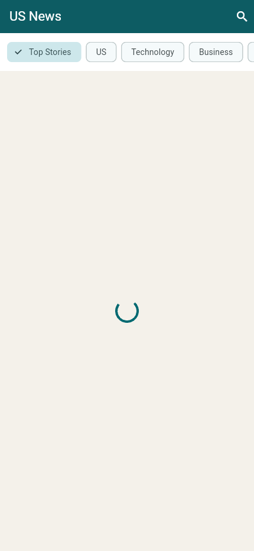
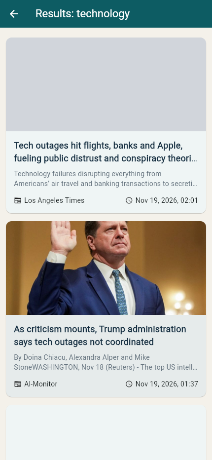
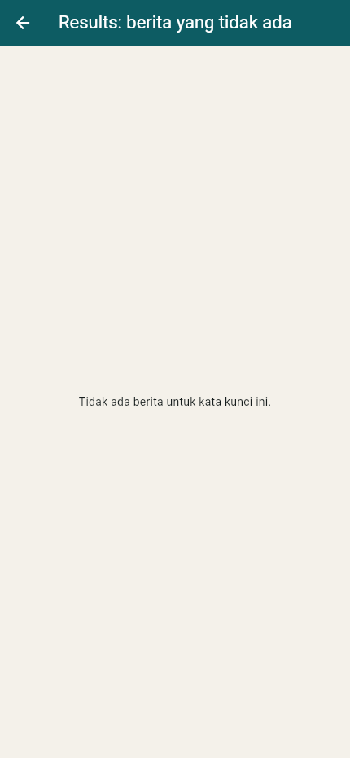
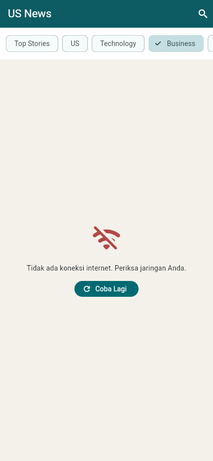
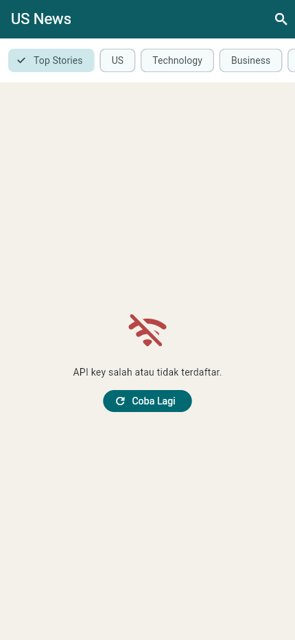

# US News — Flutter News App

News App bertema berita Amerika Serikat yang mengambil data dari GNews REST API
menggunakan Dio, ditampilkan dengan `FutureBuilder`.

## Fitur

- Daftar berita kategori Top Stories, US, Technology, Business, Sports, Health, dan Science.
- Pencarian berita melalui dialog dan halaman hasil khusus.
- Halaman detail berita dan tombol membuka sumber asli.
- Empat state: loading, data, kosong, dan error.
- Cache Future tiap kategori agar pemilihan chip tidak mengirim request berulang.
- Pull-to-refresh dan tombol Coba Lagi.
- `ApiException` dengan pesan berbeda untuk timeout, tanpa koneksi, 400, 401, 403,
  404, 429, 5xx, dan data yang tidak sesuai model.

## Konfigurasi

Salin contoh konfigurasi:

```bash
cp config/env.example.json config/env.json
```

Isi API key GNews milik Anda pada `config/env.json`. URL dan key **tidak boleh**
ditulis di kode; keduanya dibaca lewat `--dart-define-from-file`.

Jalankan aplikasi:

```bash
flutter run --dart-define-from-file=config/env.json
flutter run -d chrome --dart-define-from-file=config/env.json
```

Tanpa `--dart-define-from-file`, aplikasi akan menampilkan pesan
"Konfigurasi belum diisi" (skenario error yang memang disengaja).

Jangan commit `config/env.json`. File tersebut sudah masuk `.gitignore`.

## Struktur

- `lib/models`: model artikel dan response.
- `lib/services`: Dio service dan `ApiException`.
- `lib/views`: home, pencarian, dan detail.
- `lib/widgets`: card artikel, gambar, dan tampilan error.
- `lib/routes`: route aplikasi.
- `lib/utils`: warna dan format tanggal.

## Testing

```bash
flutter analyze
flutter test
flutter build web --release --dart-define-from-file=config/env.json
flutter build apk --debug --dart-define-from-file=config/env.json
```

Hasil terakhir: `flutter analyze` tanpa issue, 33 test lulus, build web release
berhasil, dan APK debug berhasil dibangun. Detail pengujian ada di `TESTING.md`.

## Galeri Screenshot

Semua screenshot diambil dari build web release di Chrome dengan viewport
430×932.

### Layar dan State Utama

| State | Screenshot |
|---|---|
| Loading | <a href="screenshots/01_loading.png"></a> |
| Daftar berita | <a href="screenshots/02_home_data.png"></a> |
| Kategori Technology | <a href="screenshots/03_category_technology.png"></a> |
| Dialog pencarian | <a href="screenshots/04_search_dialog.png"></a> |
| Hasil pencarian | <a href="screenshots/05_search_results.png"></a> |
| Detail berita | <a href="screenshots/06_detail.png"></a> |
| State kosong | <a href="screenshots/07_empty_state.png"></a> |
| Retry berhasil | <a href="screenshots/11_retry_success.png"></a> |

### State Error

| Skenario | Screenshot |
|---|---|
| Tidak ada koneksi | <a href="screenshots/08_error_offline.png"></a> |
| API key salah (HTTP 401) | <a href="screenshots/09_error_api_key_salah.png"></a> |
| Konfigurasi kosong | <a href="screenshots/10_error_config_empty.png"></a> |

## Catatan keamanan

API key development di `config/env.json` hanya untuk latihan. Untuk production,
gunakan proxy (misalnya Cloudflare Workers) agar key tidak ikut ke APK/web bundle.
Jika key pernah ter-commit atau terkirim ke tempat publik, rotasi key di dashboard
GNews.

## Mengganti tema

Untuk memakai berita Indonesia, ubah `lang` dan `country` di
`lib/services/news_api_service.dart` menjadi `id`, lalu sesuaikan label kategori,
judul aplikasi, dan locale tanggal di `main.dart`.
